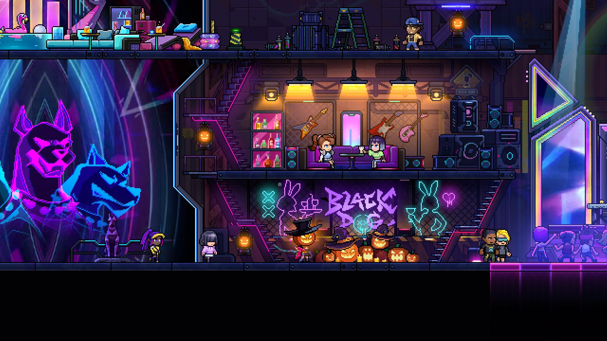

# 万圣节版本更新公告
注意：更新版本可能会造成继续游戏的数据错误，请完成当前局后再进行更新。

# 默认分支更新
---
### 新增内容与调整
- 万圣节活动开启：活动期间登录游戏并进入酒吧，可领取第一档奖励；任意通关一次游戏，可领取第二档奖励。
- 酒吧换上万圣节主题，更新节日活动界面与装扮特效，并修复切换场景后活动图片丢失的问题。
- 支持者礼包新增节日装扮奖励。
- 灵魂房支持连续升级：保留尚未选择的奖励，后续升级会追加新的二选一奖励组，各组可独立选择与重掷。
- 合并部分重复武器词缀并兼容旧存档；合并后的重复条目保留较高品质，同时修正部分词缀名称。
### 战斗与道具修复
- 修复大惊奇方块重掷时道具来源与抽取记录异常，以及断线接管后掉落坐标回跳的问题。
- 修复大惊奇方块生成的战斗在离房重入后状态异常、阻塞挑战集合的问题。
- 修复徽章商店部分道具池未正确参与抽取的问题。
- 修复卸下熏黑坩埚后，水晶仍触发爆炸的问题。
- 修复鹰击的导弹消失后，武器可能无法再次充能的问题。
- 优化无界无人机追击标记目标和返回玩家身边的表现。
- 修复棱镜切换房间后重复生成激光，以及循环音效残留的问题。
- 修复通过角色技能切换武器后，蓄力环和特效残留的问题。
- 修复喷涂获得伤害加成词缀后，伤害数值计算异常的问题。
- 修复随从数量类词缀的部分品质加成未正确生效的问题。
- 修复部分附加效果道具阻断球类与泡泡武器自动攻击的问题。
- 修复卡茜轮盘提前按停时，输入被技能冷却吞掉的问题。
- 修复法眼在队友视角下错误置灰及特效透明度异常的问题。
- 修复暗灵临时隐藏与复活时的状态恢复异常。
- 修复复活或救援后无敌保护被错误覆盖，以及辐射血清在死亡期间错误触发移动和无敌刷新的问题。
### 联机与交互修复
- 联机战斗统一同步主机的难度设置，完善同步失败时的退出处理。
- 修复客机断线重连后信仰状态恢复不完整，以及切换信仰时错误继承其他信仰进度的问题。
- 修复武器信仰房的免费使用次数未按玩家独立计算的问题。
- 修复工匠房中多人可同时拿走同一轮不同徽章奖励的问题。
- 修复存取装置联机同时取出时资源复制及余量显示异常的问题；存取按各自个人存档结算。
- 修复持握物失效后，投弹、技能和罐子交互可能卡住的问题。
- 修复更换奇物后，换下的道具被重复锁定、无法再次拾取的问题，同时保留房间领取限制。
- 修复客机训练房假人和装置模式不同步的问题，重复进入时保留选定模式。
- 修复联机尖刺宝箱的客机表现不同步的问题。
- 修复炸弹开启轮盘宝箱时可能提前锁住交互，以及轮盘结算完成前房间提前隐藏的问题。
- 修复金币信仰献祭与附近 NPC 交互可能互相干扰的问题。
- 缩小酒吧音乐机的交互范围，减少与附近交互的干扰。
### Boss 与关卡修复
- 为部分缺少出生保护的 Boss 补齐保护，减少刚出场即被击杀导致流程异常的情况。
- 修复角色体型变大后，普罗米修斯战斗平台被异常抬高的问题。
- 调整缇雅战斗中的碰撞与锁定点。
- 修正 AI 之神的瞄准点。
- 修复组合怪物延迟出现后，清场仍无法开门的问题。
- 修复起始房间重复平台与碰撞问题。
- 修复已开启石箱仍可重复触发产虫效果的问题。
- 修复死亡过渡期间仍可触发传送门的问题。
- 修复部分房间的遮罩显示问题。
### 存档、操作与界面修复
- 修复首次继续游戏时，武器词缀被初始化覆盖的问题。
- 完善安全屋续局失败时的存档保护与恢复。
- 修复武器升级奖励延迟生成异常，以及对应武器信息丢失的问题。
- 优化手柄右摇杆操作：短拨用于选敌，长推用于方向攻击；手动攻击模式下选敌后可立即攻击，并恢复无锁定目标时短拨攻击。
- 修复近距离自动攻击持续等待，以及部分摇杆操作与武器交互冲突的问题。
- 优化瞄准指示器与实际枪口方向的对应，修复移动目标自动开火问题；默认关闭武器攻击方向箭头。
- 缩短拾取提示横幅的停留时间至 1 秒。
- 修复结算门交互与暂停操作竞争时，结算页面可能不可见的问题。
- 修复“全凭感觉”命运错误隐藏技能图标、冷却条和装填提示的问题。
- 修复局内命运和哈基宝界面的选中框不显示的问题。
- 修复 Boss 路线图翻页箭头缺失的问题。
- 修正“战争之王”相关任务中与炸弹微笑柜台交易的统计。
- 修复酒吧苦难度招牌小人的动画显示。
- 修复翻滚期间部分装扮粒子的跟随表现。
- 更新部分多语言文本。
---
**Veewo Games**