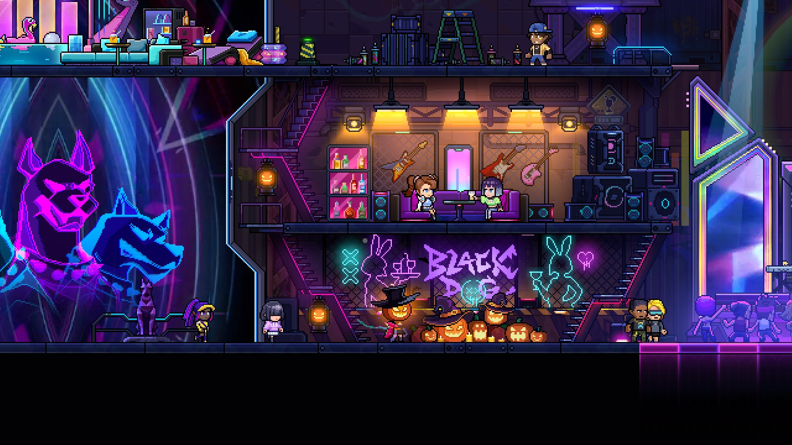

# Update Notes
Please finish your current run before updating, as updating may cause issues with in-progress runs.

# Default Branch Update
---
### New Content and Adjustments
- The Halloween event is here! Log in and enter the bar during the event to claim the first reward. Clear a run to claim the second reward.
- The bar has a Halloween theme, with updated event visuals and cosmetic effects. Fixed event images disappearing after changing scenes.
- Added a holiday cosmetic to the Supporter Pack rewards.
- Soul Rooms now support consecutive upgrades. Unclaimed rewards remain available, and each further upgrade adds a new pair of rewards. Each pair can be selected from and rerolled independently.
- Consolidated some duplicate weapon affixes while maintaining compatibility with existing saves. When affected duplicate entries are merged, the higher-quality version is retained. Corrected some affix names.
### Combat and Item Fixes
- Fixed incorrect item sources and draw history when rerolling with Great Wonder Block, and drops snapping back to old positions after disconnect takeover.
- Fixed battles spawned by Great Wonder Block entering an incorrect state after leaving and re-entering a room, preventing players from gathering to start a challenge.
- Fixed some item pools not being included correctly in badge shop draws.
- Fixed crystals still exploding after Charred Crucible was unequipped.
- Fixed Raptor sometimes failing to charge again after its missiles were gone.
- Improved how WJI drones pursue marked targets and return to the player.
- Fixed Prism generating duplicate lasers after changing rooms and looping sounds continuing to play.
- Fixed charge rings and effects remaining after switching weapons through character skills.
- Fixed incorrect damage calculations when Splash received damage-boosting affixes.
- Fixed bonuses at some rarities of minion-count affixes not taking effect correctly.
- Fixed certain additional-effect items preventing ball and bubble weapons from attacking automatically.
- Fixed Cassie’s roulette stop input being ignored during skill cooldown when pressed early.
- Fixed Horux incorrectly appearing greyed out to teammates and incorrect effect transparency.
- Fixed Wisp state restoration issues involving temporary hiding and revival.
- Fixed invincibility protection being overwritten after revival or rescue, and Radiation Serum incorrectly allowing movement or refreshing invincibility during death.
### Co-op and Interaction Fixes
- Co-op battles now synchronize the host’s difficulty settings, with improved handling when synchronization fails.
- Fixed incomplete restoration of clients’ faith state after reconnecting, and progress from one faith being incorrectly carried over to another.
- Fixed free uses in weapon faith rooms not being tracked separately for each player.
- Fixed multiple players being able to claim different badge rewards from the same reward round in the Artisan Temple.
- Fixed resource duplication and incorrect remaining balances when multiple players withdrew resources at the same time in co-op. Deposits and withdrawals are now tracked separately in each player’s personal save.
- Fixed invalid held objects potentially blocking bomb throwing, skills, and jar interactions.
- Fixed unequipped curios being incorrectly locked and becoming impossible to pick up again. Room reward limits still apply.
- Fixed training room dummies and device modes not synchronizing for clients. The selected mode is retained when re-entering.
- Fixed client visuals for spike chests not synchronizing correctly in co-op.
- Fixed interactions potentially locking too early when opening roulette chests with bombs, and rooms hiding before roulette resolution finished.
- Fixed coin-faith sacrifices and nearby NPC interactions potentially interfering with each other.
- Reduced the bar music player’s interaction area to reduce interference with nearby interactions.
### Boss and Room Fixes
- Added missing spawn protection to some bosses to prevent progression issues caused by defeating them immediately on spawn.
- Fixed platforms in the Prometheus fight being raised incorrectly when the player grew larger.
- Adjusted collision and targeting points in the Theia fight.
- Corrected the targeting points on the God of AI.
- Fixed doors failing to open after clearing rooms containing enemies with delayed combined spawns.
- Fixed duplicate platforms and collision issues in starting rooms.
- Fixed opened stone chests repeatedly triggering insect-spawning effects.
- Fixed portals being usable during the transition into death.
- Fixed visual masking issues in certain rooms.
### Save, Control, and Interface Fixes
- Fixed weapon affixes being overwritten during initialization when continuing a run for the first time.
- Improved save protection and recovery when continuing from a safehouse fails.
- Fixed issues with delayed weapon upgrade rewards, including lost information about the weapon that triggered the upgrade.
- Improved right-stick controls: flick to select a target and hold a direction to attack. In manual attack mode, selecting a target can trigger an immediate attack. Restored flick attacks when no target is locked.
- Fixed automatic attacks getting stuck waiting at close range and conflicts between certain stick inputs and weapon interactions.
- Improved alignment between aiming indicators and the actual muzzle direction, and fixed automatic firing at moving targets. Weapon attack-direction arrows are disabled by default.
- Reduced pickup banner display time to 1 second.
- Fixed the results screen potentially becoming invisible when interacting with an end-of-run portal while pausing.
- Fixed the “Rely on Instinct” Fate incorrectly hiding skill icons, cooldown bars, and reload prompts.
- Fixed selection outlines not appearing on the in-run Fate and Hatchmon screens.
- Fixed missing page arrows on the boss roadmap.
- Corrected tracking of transactions with the Bomb Smiley Counter for the Lord of War task.
- Fixed the animation of the character on the bar’s Abyssal Difficulty sign.
- Fixed how some cosmetic particles follow the character during rolls.
- Updated some localized text.
---
**Veewo Games**